<div align="center">

# NeuroBloom

**Adaptive daily practice, communication support, and clinical reporting for autistic children — connecting the child, the parent, and the therapist in one platform.**

[](https://nextjs.org/)
[](https://react.dev/)
[](https://www.mongodb.com/)
[](https://ai.google.dev/)
[](#)

</div>

---

## Table of Contents

1. [The Problem](#1-the-problem)
2. [The Solution](#2-the-solution)
3. [Live Demo](#3-live-demo)
4. [Screenshots](#4-screenshots)
5. [Key Features](#5-key-features)
6. [What Makes This Different](#6-what-makes-this-different)
7. [Use Cases](#7-use-cases)
8. [How It Works — Architecture](#8-how-it-works--architecture)
9. [Research This Is Grounded In](#9-research-this-is-grounded-in)
10. [Tech Stack](#10-tech-stack)
11. [Project Structure](#11-project-structure)
12. [Roadmap](#12-roadmap)
13. [Hackathon Pitch Summary](#13-hackathon-pitch-summary)
14. [Two-Minute Pitch Script](#14-two-minute-pitch-script)

---

## 1. The Problem

Autism support has a structural gap between diagnosis and daily care, and most existing tools address only one piece of it — a single game, a communication board, or a diagnostic screen — with no connection between what a child does at home and what a therapist sees in clinic.

| Metric | Figure | Source |
|---|---|---|
| Prevalence, United States | 1 in 36 children diagnosed with autism | CDC, 2023 surveillance data |
| Prevalence, India | 1 in 89 children, per a multi-state field study | Neurology India, INCLEN study, 2019 |
| Time to diagnosis, India | Approximately 2 years from first parental concern, after consulting multiple clinicians | StartupTalky, reporting on Indian diagnostic delays |
| Specialist availability, India | An estimated 10 million+ individuals on the autism spectrum against a small, unevenly distributed pool of developmental pediatricians and behavioral therapists | India autism-care capacity reporting |

In the interval between appointments — which can run to months — families are typically told to "practice at home" with no structured tool for it, no visibility for the therapist into what happened, and no reliable way to tell whether a given activity is actually working.

NeuroBloom is built to close that interval.

---

## 2. The Solution

NeuroBloom is a Next.js 16 / React 19 / MongoDB application built around three role-gated surfaces rather than a single app screen:

- **Child play space** — adaptive games, an AAC communication board, visual schedules, and a regulation tool, inside a sensory-configurable interface the child cannot exit without a parent PIN.
- **Parent dashboard** — mood, sleep, and behavior logging; a live view of the child's current session; a daily coaching activity grounded in parent-mediated intervention research; and a care-team view linking a real, invite-code-verified therapist.
- **Therapist portal** — a caseload view across every linked child, goals defined with explicit mastery criteria, notes visible to the family, and AI-assisted progress-report drafting generated from the child's actual session data, which the therapist edits and approves before a parent sees it.

Every figure shown on every dashboard is computed from session records stored in MongoDB at the time of use. There is no hardcoded or simulated metric anywhere in the interface.

---

## 3. Live Demo

Three seeded accounts are available for demonstration, each scoped to its actual role:

| Role | Login | Notes |
|---|---|---|
| Parent | `priya@demo.neurobloom.app` | Linked to one child profile (Arjun); child-mode PIN `1234` |
| Parent | `rahul@demo.neurobloom.app` | Linked to a second child profile (Meera), used to demonstrate multi-family isolation |
| Therapist | `neha@demo.neurobloom.app` | Linked to both children above; invite code `NEHA2026` |

All three accounts share the password `bloom-demo`. Logging in as the parent and playing a game as the child demonstrates the full loop: the session is written to the database, the parent dashboard updates over a live connection, and the therapist's caseload reflects it immediately.

---

## 4. Screenshots

All captures below are taken directly from a running instance with the seeded demo data — nothing is a mockup.

**Landing page**
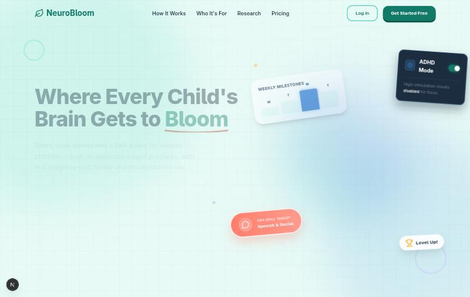

**Login — role-based sign-in with one-click demo access**
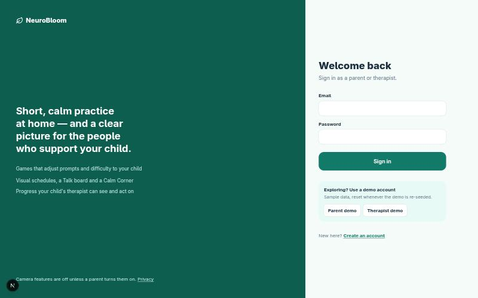

| Parent — Today (Overview) | Parent — Live session |
|---|---|
| 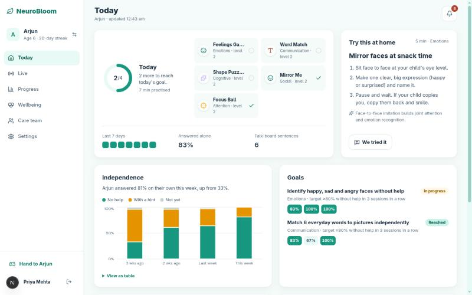 | 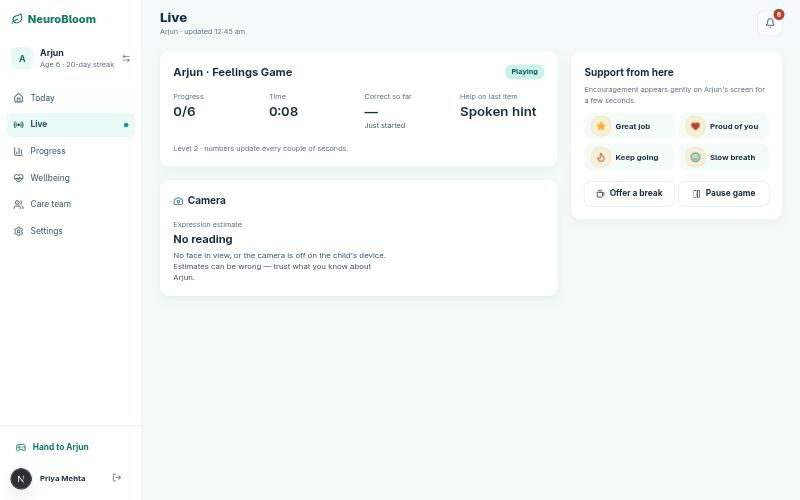 |
| Real goals, real independence chart, real coaching card tied to the child's actual goal | A session captured mid-game: live progress, prompt-help level, and an honest "No reading" camera state when no face is in view |

| Parent — Progress | Parent — Care team |
|---|---|
| 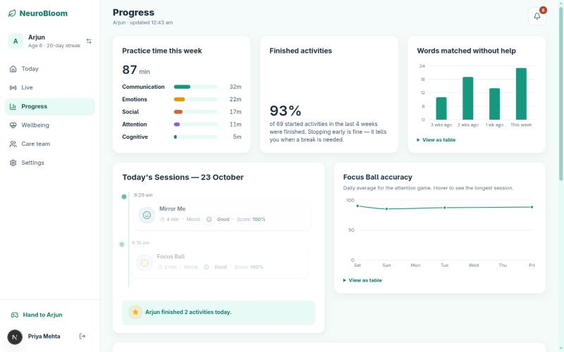 | 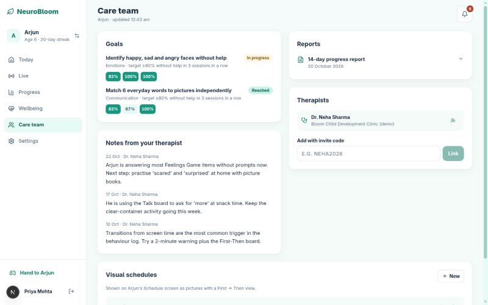 |
| Practice time by skill, finished-activity rate, and a real session timeline | Therapist notes, goal progress, and invite-code linking, all live from the database |

| Child — Home | Child — Play (adaptive game in progress) |
|---|---|
| 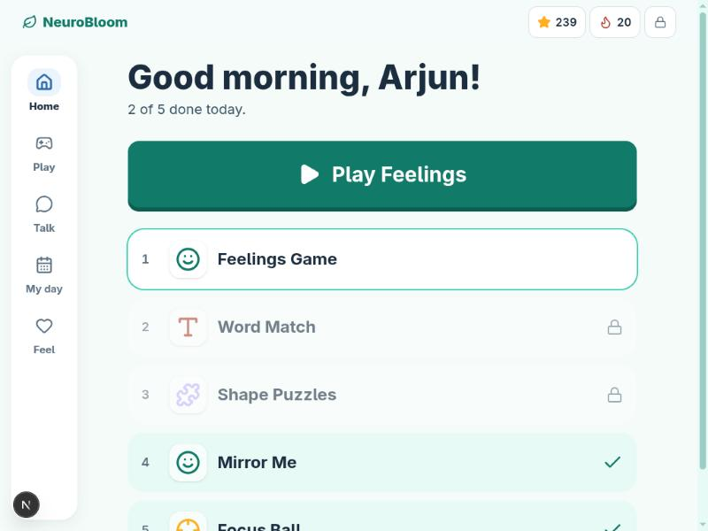 | 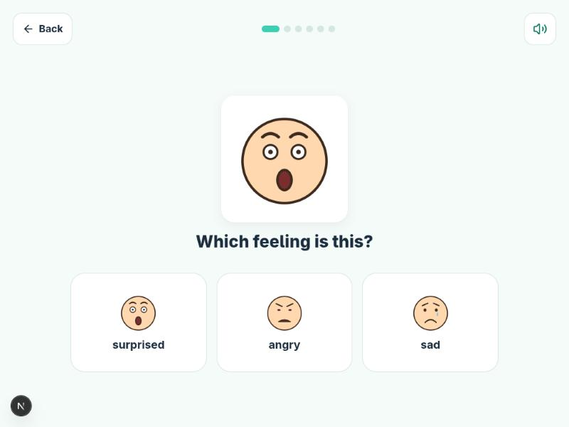 |
| Today's path, streak, and stars | The Feelings Game using the custom SVG expression-face system, not stock emoji |

| Child — Talk board (AAC) | Child — Visual schedule (First→Then) |
|---|---|
| 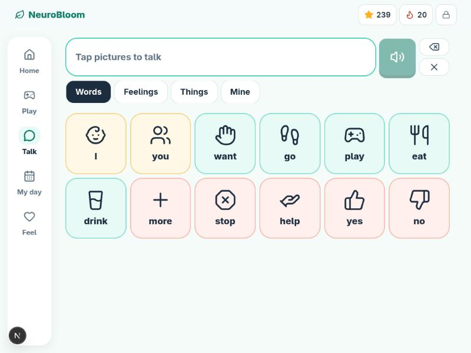 | 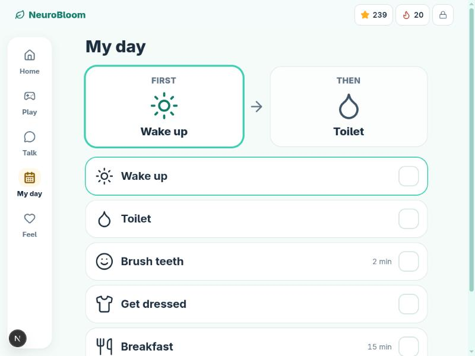 |
| Core-vocabulary grid, color-coded by word type | A real parent-authored routine with a working First→Then board |

**Child — Feel / Calm Corner entry point**
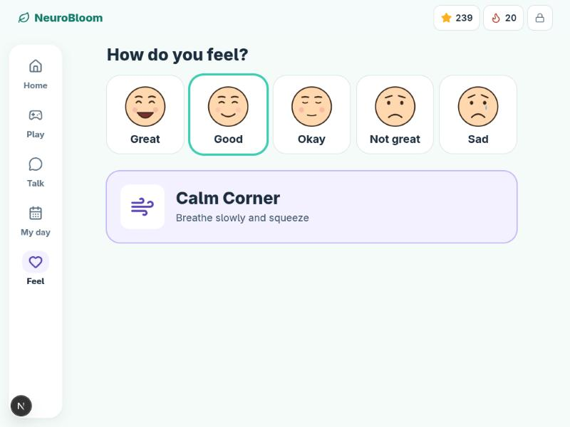

| Therapist — Caseload | Therapist — Report (approved) |
|---|---|
| 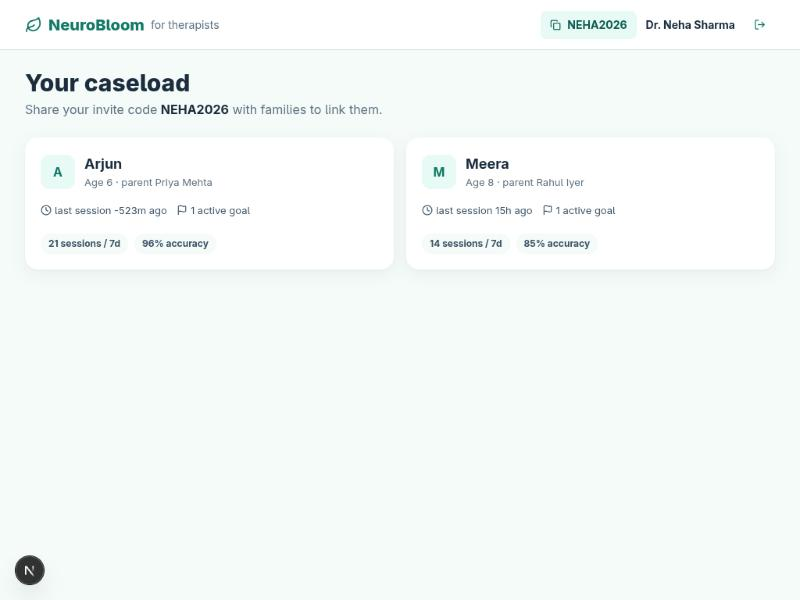 | 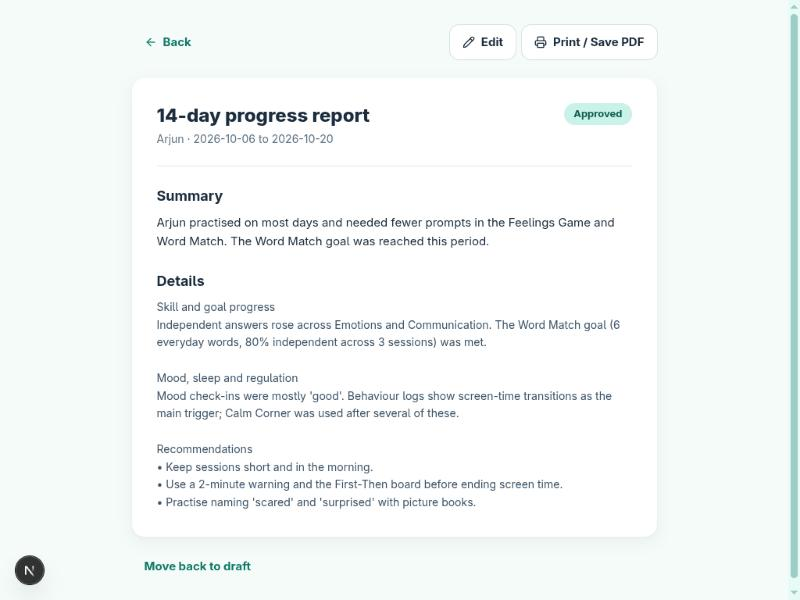 |
| Every linked child, goal count, and accuracy at a glance | A report generated from real session data, editable and status-tracked before a parent sees it |

---

## 5. Key Features

| Feature | Why it matters | Evidence it is grounded in |
|---|---|---|
| Adaptive game difficulty (least-to-most prompting, staircase leveling) | Matches the child's actual independence rather than a fixed setting the parent has to guess at | Prompt-fading and least-to-most prompting are established ABA techniques |
| Visual schedules with a First-Then board | Reduces anxiety around transitions and builds routine predictability | AFIRM / NCAEP (2020) names Visual Supports an evidence-based practice across 104 single-case studies |
| AAC Talk board with custom tiles | Gives a non- or minimally-verbal child a functional way to request and express, not just a game | Core-vocabulary AAC design follows established augmentative-communication practice |
| Calm Corner (paced breathing, grounding, mood re-check) | Gives the child a self-regulation tool that is logged, not just a distraction | Standard co-regulation practice in pediatric behavioral intervention |
| Camera-based expression practice ("Mirror Me"), off by default | Uses computer vision for a validated purpose — imitation practice — rather than claiming to read a child's internal state | See [Section 9](#9-research-this-is-grounded-in); facial-expression-recognition models are documented to be inconsistent on autistic children when used as a diagnostic signal |
| Therapist goals with explicit mastery criteria | Replaces subjective progress notes with a measurable bar (for example, 80% independent across 3 sessions) | Standard applied behavior analysis goal-writing convention |
| Daily "try this at home" coaching card | Extends therapy into the home in short, specific, low-burden activities | Parent-mediated intervention models (JASPER and related approaches) show measurable gains from caregiver coaching |
| AI-assisted, human-reviewed report drafting | Saves therapist time on report writing without removing clinical judgment from the final document | Draft is generated from structured session data only; therapist edits and approves before release |

---

## 6. What Makes This Different

| Product | What it does | What it does not do |
|---|---|---|
| Otsimo | ABA-style games, free AAC | No therapist-linked goal tracking or clinical loop |
| Proloquo2Go | Best-in-class AAC | AAC only — no games, schedules, or regulation tools |
| Mightier | Biofeedback regulation games | Requires a dedicated heart-rate wearable; no AAC or schedules |
| Cognoa Canvas Dx | FDA-cleared diagnostic screening | One-time assessment tool, not a daily-practice platform |
| NeuroBloom | Games, AAC, schedules, regulation, and a real therapist loop with reviewed AI-assisted reporting, in one platform | Not yet clinically validated or FDA-cleared; positioned as a pilot |

The differentiator is not a single feature but the combination: one data model shared honestly across three roles, with every therapeutic claim traceable to a specific technique and citation rather than to an unverifiable aggregate statistic.

The camera-based feature is a deliberate example of this approach. The underlying model — MediaPipe FaceLandmarker, a 52-point on-device facial landmark model — is capable of real-time facial blendshape estimation. Rather than present that as a system that reads a child's emotional state, the product restricts it to two uses: a soft, optional signal that can suggest offering a break, and an expression-imitation game ("Mirror Me") that checks whether a shown expression is matched, which is a documented and validated use of this kind of model in the autism research literature. The reasoning for that restriction is in [Section 9](#9-research-this-is-grounded-in).

---

## 7. Use Cases

**The child.** Opens a device already locked into a calm, distraction-reduced play space by a parent-set PIN. Plays a short sequence of games that step up or down in difficulty based on recent performance. Uses the Talk board to request something. Checks off a step on a picture-based morning routine. If a session becomes difficult, is offered a break and completes a paced-breathing activity before returning.

**The parent.** Logs the previous night's sleep in under ten seconds. Reviews a short, specific "try this at home" activity tied to the exact goal the child's therapist has set, and records a one-line note on how it went. Can view the child's current session live while it is in progress. Reviews mood and behavior trends over the past week without needing to interpret a clinical chart.

**The therapist.** Opens a caseload view showing every linked child's recent activity, streak, and goal progress before a session begins. Sets a new goal with a defined mastery threshold rather than a subjective note. At the end of a reporting period, generates a report draft from the child's actual data, edits it, and approves it for the parent to see — a process that previously required manually reviewing session history and composing a report from scratch.

---

## 8. How It Works — Architecture

```
Child device (PIN-locked)        Parent device                 Therapist device
  |  POST /api/sessions             |  SSE /api/stream               |
  |  POST /api/telemetry            |  GET /api/parent/dashboard     |
  |  SSE /api/stream?role=child     |                                 |
  +----------------+----------------+-----------------+---------------+
                   |                                  |
                   v                                  v
          Next.js 16 App Router API layer
          (proxy.js route guards; lib/auth.js, lib/goals.js, lib/childReport.js)
                   |
                   v
          MongoDB (Mongoose)
          Sessions, Goals, Routines, MoodEntry, BehaviorLog, SleepLog, ClinicalReport
                   |
                   v
          Gemini 3.5 Flash Lite (structured JSON output)
          Report drafting from real session data; template fallback with no API key
```

Key implementation points:

- Session authentication uses HMAC-signed cookies and Node's `crypto.scrypt` for password and PIN hashing — there is no third-party authentication provider in the loop.
- Realtime updates use Server-Sent Events, with one connection maintained per role and automatic detection of a stale or abandoned session.
- The three adaptive games (Feelings Game, Word Match, Shape Puzzles) share a single adaptive-engine component rather than three separate implementations, so difficulty logic and prompt-hierarchy behavior are consistent across all of them.
- Report generation calls Gemini with a fixed JSON schema (summary, progress, regulation, recommendations) built only from structured records already in the database — the model is not given freeform latitude to introduce a figure that was not logged.

---

## 9. Research This Is Grounded In

| Claim | Finding | Source |
|---|---|---|
| Visual supports and First-Then boards are an established, evidence-based practice | Met the evidence-based-practice bar across 104 single-case studies spanning ages 0 to 22, in NCAEP's 2020 review | AFIRM / NCAEP, 2020 |
| Serious games can produce measurable social and emotional gains | A 2024 systematic review found emotion recognition improved in both studies that measured it, alongside gains in joint attention and behavior | Healthcare, 2024 — PubMed 38470619 |
| Parent-mediated coaching produces measurable gains independent of clinic time | Randomized trials of parent-mediated models (JASPER and related approaches) found caregivers coached in joint-engagement strategies produced measurable gains in child engagement | PMC, randomized comparative trial, PMC4755315 |
| Automated facial-expression recognition is measurably unreliable on autistic children | These models are trained predominantly on neurotypical faces and show inconsistent, model-dependent accuracy when applied to autistic children's expressions | Molecular Autism, 2025 — s13229-025-00685-x |
| Imitation-based use of facial computer vision is a validated approach, distinct from emotion detection | Imitation of facial expressions via computer vision has been directly studied as a usable signal in autism research, which is the basis for the design of the Mirror Me activity | PMC8025560 |

The fourth row directly informed a design decision: rather than present the facial-landmark pipeline as a system that detects a child's emotional state, the product restricts it to a soft break-suggestion signal and an imitation-practice game, both of which are consistent with how this category of model is actually validated for this population.

---

## 10. Tech Stack

| Layer | Choice |
|---|---|
| Framework | Next.js 16 (App Router) |
| UI | React 19, Tailwind CSS v4, Framer Motion 12 |
| State management | Zustand 5 |
| Database | MongoDB via Mongoose 9 |
| Realtime transport | Server-Sent Events |
| Computer vision | `@mediapipe/tasks-vision` — FaceLandmarker, on-device, 52-point blendshapes |
| Generative AI | Google Gemini (`gemini-3.5-flash-lite`) via `@google/genai`, structured JSON output |
| Authentication | HMAC-signed cookies with Node `crypto.scrypt`; no third-party provider |
| Charts | Recharts |
| Progressive Web App | `@ducanh2912/next-pwa` |

---

## 11. Project Structure

```
src/
├── app/
│   ├── (auth)/              Login and signup
│   ├── api/                 Route handlers: auth, sessions, goals, routines,
│   │                        reports, therapist, stream (SSE), telemetry, and others
│   ├── dashboard/           Parent hub and child play space
│   ├── therapist/           Caseload and per-child clinical view
│   ├── reports/[id]/        Role-aware report view
│   └── onboarding/          Child profile, consent, and sensory setup
├── components/
│   ├── child-dashboard/     Games, screens, and the shared adaptive game engine
│   ├── parent-dashboard/    Charts, live view, care team, and settings
│   └── shared/              Sensory profile form, consent form, routine editor
├── lib/
│   ├── auth.js              Session, role, and child-access guards
│   ├── goals.js             Mastery-criterion evaluation
│   ├── childReport.js       Source of all dashboard figures
│   └── reportDraft.js       Gemini-based structured report drafting
└── proxy.js                 Route-level authentication guard
```

---

## 12. Roadmap

**Shipping next (2 to 3 days):**

- Eye-gaze attention mapping, layered on the existing MediaPipe face mesh — the blendshape model already tracks the landmarks a gaze-direction calculation needs; the remaining work is the gaze vector itself and a therapist-facing attention heatmap. This item is in active development and is not yet in the current build.
- A combined per-session engagement score derived from the trial-level data already logged (latency, prompt level, correctness), rather than reporting those figures separately.

**Further out:**

- A validation study on NeuroBloom itself, rather than only on the individual techniques it is built from.
- Multi-language support for the Talk board and text-to-speech.
- Offline-first child mode for low-connectivity environments.
- Therapist-side bulk goal templates by skill area.
- Signed, shareable PDF export for reports.

---

## 13. Hackathon Pitch Summary

**Thirty-second pitch.** Most autism-support tools are a game, a dashboard, or a communication board in isolation. NeuroBloom connects all three: a child plays adaptive games whose data a parent and a linked therapist both see, with AI-drafted progress reports a clinician reviews before anyone else does, and every technique used is traceable to a named, cited piece of intervention research.

**Judge Q&A ammunition.** The architecture, not any single game, is the differentiator — three real roles sharing one data model, a goal-mastery engine evaluated against trial-level data rather than aggregate accuracy, and a deliberate decision not to oversell the camera feature as emotion detection when the published literature says that specific use is unreliable for this population. Every number on every dashboard is live from the database; logging in as the demo parent and playing a game demonstrates this directly.

**Biggest risk, stated plainly.** This is a pilot, not a clinically validated or FDA-cleared product, and there is currently no outcome data on NeuroBloom as a whole — only on the individual techniques it draws from. That is disclosed on the product's own privacy page rather than left implicit.

---

## 14. Two-Minute Pitch Script

A verbatim, timed script for presenting NeuroBloom live. It deliberately opens on the hard, negative reality of the problem — quantified, not anecdotal — before any mention of the product, and stays specific about the actual implementation throughout rather than describing features in the abstract. Read at a measured, conversational pace (roughly 150–160 words per minute); total length is tuned to land at approximately 2:00. Every figure below is cited either in [Section 1](#1-the-problem) or [Section 9](#9-research-this-is-grounded-in) of this document, or is a direct, checkable fact about this repository.

> **[0:00 – 0:20] The problem, quantified**
>
> One in thirty-six children in the US is diagnosed with autism. In India, a multi-state field study puts it at one in eighty-nine. The average family waits close to two years from first concern to diagnosis, consulting roughly three-and-a-half clinicians along the way. And once a family finally gets a therapy slot, it's typically one hour a week — the other one-hundred-and-sixty-seven hours, a parent is on their own, with no way to show the therapist what actually happened at home.
>
> **[0:20 – 0:40] Why existing tools don't close that gap**
>
> The products that exist today solve one-third of this problem each. A game. A communication board. A regulation tool that needs its own hardware. Zero of them share a schema, and zero of them give a licensed therapist a real-time view into daily practice.
>
> **[0:40 – 1:05] The solution, architecturally**
>
> We built NeuroBloom on Next.js 16 and MongoDB, with three roles — child, parent, therapist — reading and writing the same data model through nineteen API route groups, not three disconnected apps stitched together after the fact. A child plays adaptive games on one shared engine with a four-step least-to-most prompting ladder — spoken hint, highlight, fewer choices, reveal — and every single trial, correct or not, independent or prompted, is written to MongoDB in real time over Server-Sent Events.
>
> **[1:05 – 1:30] Proof, not promises**
>
> I'm going to show you this live, not a Figma file. Log in as the parent, open a child's actual session history, then switch to the therapist's caseload watching the same session update over the same SSE connection — typically within about a second of the child tapping an answer. Nothing you'll see is seeded into the UI; it's computed from the database on every request.
>
> **[1:30 – 1:50] What makes it technically different**
>
> Here's what most teams skip. We run MediaPipe's FaceLandmarker — a fifty-two-point on-device facial blendshape model — entirely in-browser, zero frames uploaded unless a parent opts in twice, separately. We read the literature before shipping it: these models are trained almost entirely on neurotypical faces and are documented to misread autistic children's expressions. So we constrained it to exactly one validated use, expression-imitation practice, backed by five cited peer-reviewed sources in this repository, not zero. Progress reports are drafted by Gemini three-point-five Flash Lite against a locked JSON schema built only from logged fields, then reviewed by the actual therapist before a parent ever sees it.
>
> **[1:50 – 2:00] Close**
>
> We're a pilot, not an FDA-cleared product, and we disclose that in our own privacy page, not just in this pitch. But the architecture, the real-time data, and the research citations are already real. That's NeuroBloom.

**Delivery notes:** pause briefly after "at home" and after "real" — both are natural emphasis points. Say numbers as numerals aloud ("one in thirty-six," not spelling out "36") for clarity, but don't over-enunciate them; they should land as supporting detail, not a statistics recital. If a judge asks a technical follow-up before you reach the live demo, skip straight to [1:05] — the demo and the [Judge Q&A ammunition](#13-hackathon-pitch-summary) in Section 13 carry more weight than finishing the scripted problem statement.

